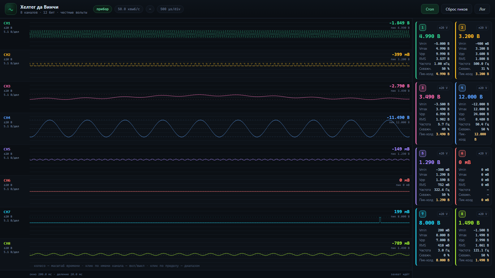
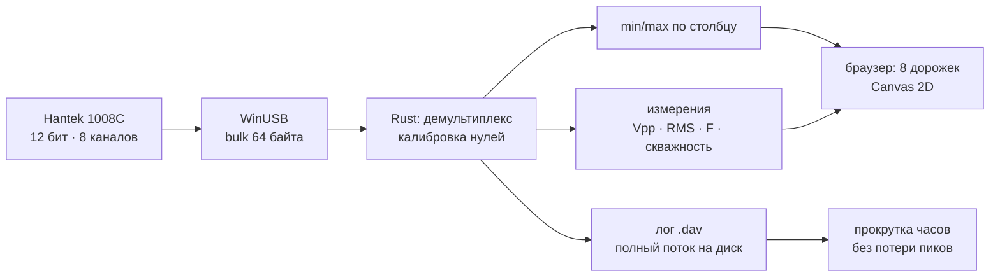
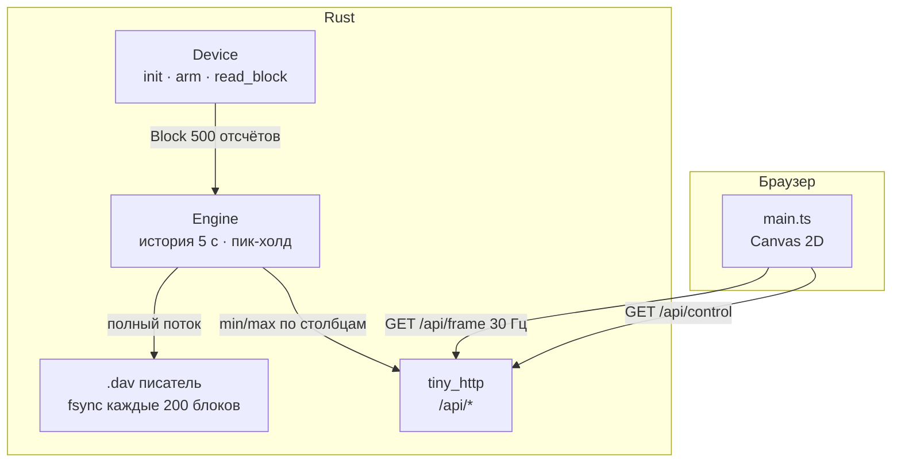

# Осциллограф Хелтег да Винчи

Замена вендорскому ПО для восьмиканального USB-осциллографа **Hantek 1008C**
(USB `0783:5725`). Сырые 12-битные отсчёты, настоящие вольты, непрерывный лог и
интерфейс, который не прячет пики за «квадратиками».



## Зачем ещё один осциллограф

Штатная программа рисует один отсчёт на пиксель: фронт превращается в ступеньку,
а глитч между пикселями исчезает совсем. Здесь на каждый столбец считается
**настоящий минимум и максимум**, поэтому пик видно всегда — включая одиночный
выброс на CH7, который на скриншоте торчит одной вертикальной чертой.



## Что уже работает

| Узел | Состояние | Проверено на |
|---|---|---|
| Протокол, команды, демультиплекс | готово | юнит-тесты + симулятор |
| Калибровка нулей по трём диапазонам | готово | юнит-тесты |
| Измерения (Vmin/Vmax/Vpp/RMS/частота/скважность) | готово | тест «меандр 1 кГц, 25 %» |
| Демон + HTTP API | готово | `--sim`, живой опрос |
| Интерфейс на 8 дорожек | готово | скриншот выше |
| Непрерывный лог `.dav` | готово | запись/чтение в симуляторе |
| Транспорт WinUSB | написано | **ждёт привязки прибора к WinUSB** |
| Вендорский драйвер | отключён | опасен, см. ниже |

> **Важно.** Прямой доступ к драйверу Hantek (`DSO6CDE`) отключён по умолчанию:
> на этой машине он дважды привёл к синему экрану `0x3B`. Подробности и
> доказательства — в [docs/REVERSE-ENGINEERING.md](docs/REVERSE-ENGINEERING.md).

## Быстрый старт

```powershell
# 1. Собрать
cargo build --release

# 2. Посмотреть интерфейс без прибора
.\target\release\davinci.exe serve --sim --ui ui\dist

# 3. Открыть
start http://127.0.0.1:7411/
```

Работа с железом требует одного действия: привязать прибор к **WinUSB**
(Zadig → `Hantek 1008C` → WinUSB). После этого:

```powershell
.\target\release\davinci.exe info     # проверить связь и измерить частоту
.\target\release\davinci.exe zero     # измерить нули АЦП (входы на землю)
.\target\release\davinci.exe serve    # боевой режим
```

Откат драйвера: Диспетчер устройств → `HANTEK1008` → Обновить драйвер → указать
`C:\Program Files (x86)\Hantek\Scope1008\Driver\Windows10`.

## Что за железо

| Параметр | Значение | Комментарий |
|---|---|---|
| Каналов | 8 | плюс 8 цифровых выходов (не используем) |
| АЦП | 12 бит | 4096 кодов, шаг 0,01 В на диапазоне ±20 В |
| Поток | 2,4 млн отсчётов/с суммарно | делится на число включённых каналов |
| На канал при 8 включённых | 300 квыб/с | при одном канале — 2,4 Мвыб/с |
| Память | 4K отсчётов на канал | буферы по 2000 |
| Диапазоны | ±0,41 В · ±2,5 В · ±20 В | переключаются на канал |
| Вход | 1 МОм, DC | |

Отсюда честная оценка лога: 8 каналов × 300 квыб/с × 2 байта ≈ **4,8 МБ/с**,
то есть около 17 ГБ в час. Это спокойно пишется на SSD.

## Архитектура



* `crates/hantek1008` — протокол, WinUSB-транспорт, калибровка, симулятор.
* `crates/davinci` — демон, движок, лог, HTTP, CLI.
* `ui` — TypeScript + Vite + CSS, рендер на Canvas 2D.

## API

| Метод | Что делает |
|---|---|
| `GET /api/info` | состояние связи, частота, блоки/с, лог |
| `GET /api/channels` | по каналу: min, max, Vpp, RMS, частота, скважность, пик-холд |
| `GET /api/frame?width=&span=` | бинарный кадр: на столбец min и max в мВ |
| `GET /api/control?cmd=run\|stop\|reset` | управление захватом |
| `GET /api/control?cmd=channels&list=1,2` | включённые каналы |
| `GET /api/control?cmd=range&ch=3&r=3` | диапазон канала |
| `GET /api/control?cmd=log_start\|log_stop` | непрерывный лог |

## План

- [x] Протокол, демультиплекс, калибровка, измерения
- [x] Демон, HTTP, интерфейс, лог
- [ ] Проверка на живом приборе после привязки к WinUSB
- [ ] Прокрутка по сохранённому логу в интерфейсе
- [ ] Режимы Trigger/Scan/Roll из libsigrok
- [ ] Экспорт в CSV/Parquet

## Лицензия

MIT. Протокол восстановлен независимо; в основе понимания лежат открытые работы
[mfg92/hantek1008py](https://github.com/mfg92/hantek1008py) и
[sigrok](https://sigrok.org/wiki/Hantek_1008C).
