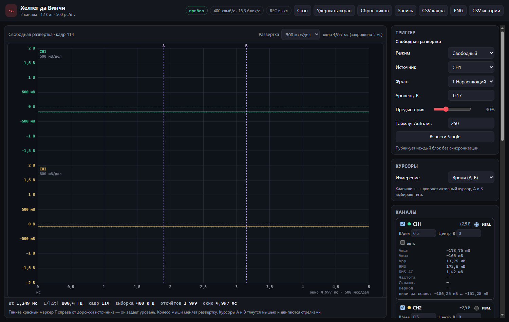
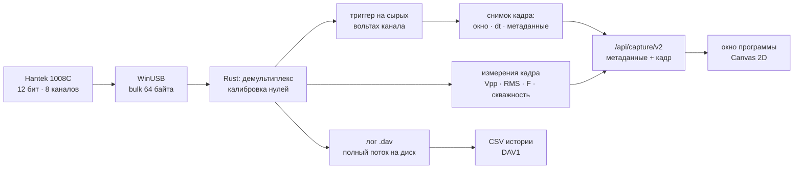
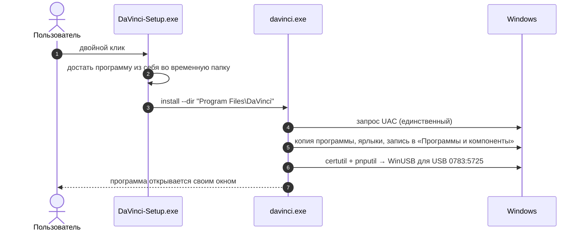
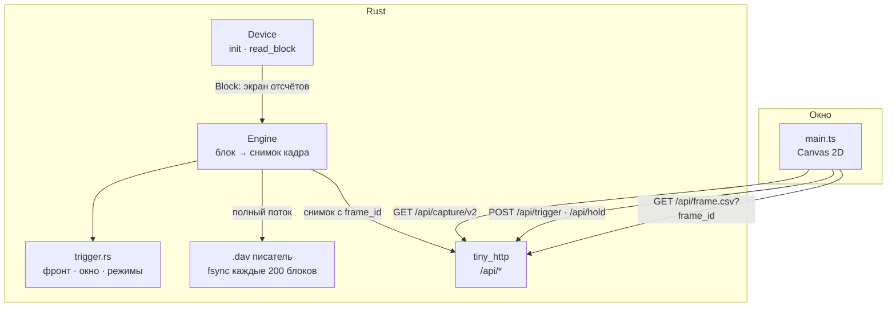

# Осциллограф Хелтег да Винчи

Замена вендорскому ПО для восьмиканального USB-осциллографа **Hantek 1008C**
(USB `0783:5725`). Сырые 12-битные отсчёты, настоящие вольты, программный
триггер, непрерывный лог и интерфейс, который не прячет пики за «квадратиками».



## Зачем ещё один осциллограф

Штатная программа рисует один отсчёт на пиксель: фронт превращается в ступеньку,
а глитч между пикселями исчезает совсем. Здесь на каждый столбец считается
**настоящий минимум и максимум**, поэтому пик видно всегда — включая одиночный
выброс, который торчит одной вертикальной чертой.

Второе отличие — **триггер считается по исходным отсчётам**, а не по картинке.
Фронт ищется на калиброванных вольтах выбранного канала с гистерезисом, время
пересечения интерполируется между двумя отсчётами, и окно ставится так, чтобы
фронт оказался в заданной доле ширины. Пока на входе шум, именно это решает,
дёргается картинка или стоит.



## Что работает

| Узел | Состояние | Проверено на |
|---|---|---|
| Протокол, команды, демультиплекс | готово | юнит-тесты |
| Калибровка нулей по трём диапазонам | готово | юнит-тесты |
| Триггер: фронт ↑/↓, уровень, гистерезис, интерполяция | готово | синтетика 125 Гц + живой прибор |
| Режимы Свободный / Auto / Normal / Single | готово | юнит-тесты + браузерный прогон |
| Окно ставится фронтом в заданную долю (10–90 %) | готово | тест: 30,0 % при заданных 30 % |
| Удержание экрана (Hold) с сохранением кадра и измерений | готово | браузерный прогон, CSV/PNG удержанного кадра |
| Курсоры A/B: Δt, 1/|Δt|, ΔV в единицах кадра | готово | браузерный прогон: 4 мс ↔ 250 Гц |
| Шкалы: подписи по 8 делениям, ноль, центр, V/дел | готово | скриншоты 1, 2 и 8 каналов |
| Ось времени: 10 делений, мкс/мс/с, фактическое окно | готово | тест: 500 мкс/дел → 4,998 мс |
| Измерения по отсчётам выбранного кадра | готово | карточки каналов, юнит-тесты |
| CSV кадра и PNG экрана (включая Hold и Single) | готово | HTTP 200 + размеры файлов |
| CSV истории из памяти | готово | 102 тыс. строк |
| Ремонт одиночных сбоев АЦП (не «мусор» на экране) | готово | юнит-тесты + 40 кадров живого шума |
| Демон + HTTP API, старый `DVF1`-клиент | готово | `/api/frame` отдаёт `DVF1` |
| Непрерывный лог `.dav` | готово | живой прибор, 232 КБ за 2 с |
| Сохранение настроек между запусками | готово | перезапуск: каналы, пределы, развёртка, триггер, центр |
| Мини-режим: отдельное окно поверх остальных, три канала | готово | живой прибор: topmost, позиция, возвраты, запись не прерывается |
| Драйвер: привязка к WinUSB без Zadig | готово | `pnputil` + живой прибор |
| Установщик, ярлыки, удаление | готово | полный цикл на этой машине |
| Вендорский драйвер | отключён | опасен, см. ниже |

> **Важно.** Прямой доступ к драйверу Hantek (`DSO6CDE`) отключён по умолчанию:
> на этой машине он дважды привёл к синему экрану `0x3B`. Подробности и
> доказательства — в [docs/REVERSE-ENGINEERING.md](docs/REVERSE-ENGINEERING.md).

## Триггер: что он делает и чего не делает

Прибор отдаёт **один экран на одно чтение** и ничего вокруг него. Между двумя
чтениями — пауза USB неизвестной длины, поэтому склеивать блоки нельзя: это
нарисовало бы ось времени, которой не было. Отсюда три следствия, и все три
видны в интерфейсе:

* **Окно — это часть блока.** Чтобы фронт оказался на 30 % ширины, окно
  сдвигается внутри блока и становится уже: перед фронтом нужно место. Сколько
  именно получилось — написано под графиком («окно 4,997 мс»), а если блоку не
  хватило данных с краю, в строке состояния появляется «обрезано» и настоящее
  положение фронта.
* **Auto ждёт фронт не дольше таймаута** (по умолчанию 250 мс) и затем
  публикует свободный кадр с явной пометкой. **Normal** в той же ситуации держит
  последний подтверждённый кадр и пишет «Ожидание фронта». **Single** берёт ровно
  один кадр на взвод и держит его до следующего.
* **Сбой АЦП — не сигнал.** Иногда прибор возвращает один отсчёт на рельсе
  (код 0) между двумя нормальными. Это не 20 В за 2,5 мкс; такой отсчёт
  заменяется средним соседей, а число исправлений показывается как «сбоев АЦП».
  В сыром `.dav`-логе остаются исходные коды — для разбора.

## Управление

| Что | Как |
|---|---|
| Пуск / Стоп | кнопка в шапке; в Stop можно рассматривать и выгружать последний кадр |
| Удержать экран | кнопка в шапке; захват и запись при этом продолжаются |
| Уровень триггера | красный маркер `T` справа от дорожки источника или поле «Уровень, В» |
| Развёртка | колесо мыши над графиком или список в панели |
| Курсоры A / B | тянуть мышью; `←` `→` двигают активный, `A` и `B` выбирают его |
| В/дел и центр | в карточке канала; предел прибора показывается отдельно |
| Запись `.dav` | кнопка «Запись» |
| CSV кадра / PNG | кнопки в шапке; сохраняют именно тот кадр, что на экране |
| Мини-режим | кнопка «Мини-режим» в шапке; назад — кнопка в мини-окне, его крестик или восстановление главного окна с панели задач |

## Мини-режим

Кнопка «Мини-режим» сворачивает главное окно штатным образом и открывает
отдельное окно **360 × 280** (при масштабе Windows 100 %) поверх остальных
окон. Это обычное окно Windows: его тянут за заголовок, ставят в любом углу и
на втором мониторе, положение запоминается. Если монитор из сохранённой позиции
отключён, окно открывается в видимой рабочей области.

Внутри ровно три графика — первые три включённых канала в порядке основного
интерфейса. Для каждого видны имя и цвет, живая осциллограмма, `U` (среднее
напряжение кадра), `Vpp`, частота и «чистота» (100 % минус доля отсчётов,
скачущих больше половины размаха; алиас и предел АЦП помечаются отдельно).
Ровная линия остаётся видимой и показывает фактический размах. Если каналов
меньше трёх, свободный график пишет «Канал недоступен»; если данные перестали
идти — «Нет данных», если нет прибора — «Отключено».

Выход — кнопка «Вернуться в основное окно», крестик мини-окна или восстановление
главного окна с панели задач. Экземпляр мини-окна всегда один.

Мини-окно только читает `/api/info`, `/api/channels` и `/api/capture/v2` и ничего
не командует прибору: переключение не переподключает его, не сбрасывает
настройки и не прерывает запись. Отрисовка ограничена кадром экрана (не чаще
`requestAnimationFrame`), опрос — примерно 10 раз в секунду, независимо от
частоты захвата.

В режиме `--browser` (страница вместо окна программы) кнопка использует Document
Picture-in-Picture — отдельное окно Chromium поверх остальных; если этого API
нет, открывается именованное всплывающее окно. В установленной программе всегда
работает нативное окно.

## Установка

Два файла, и больше ничего: ни Node, ни Python, ни отдельного менеджера
драйверов.

| Файл | Что это | Размер |
|---|---|---|
| `DaVinci-Setup.exe` | установщик: раскладывает программу, ставит драйвер, делает ярлыки | ~2,2 МБ |
| `DaVinci.exe` | программа одним файлом, интерфейс внутри — можно носить на флешке | ~1,9 МБ |

Оба файла лежат в [dist/](dist/) этого репозитория (их собирает
`tools/build-dist.ps1`) — скачивать и ставить можно без Rust и Node.

Установщик делает четыре шага и один раз спрашивает разрешение администратора:



Если программа уже запущена, установщик закрывает её сам и продолжает — это
исправлено в 0.1.1 после `os error 32`.

Проверить, что всё на месте, можно одной командой:

```powershell
& "C:\Program Files\DaVinci\davinci.exe" doctor
```

Удаление — «Программы и компоненты» → «Осциллограф Хелтег да Винчи», или
`davinci uninstall`. Драйвер при удалении остаётся: он принадлежит системе, а не
программе (как снять — написано в [driver/README.md](driver/README.md)).

Подробности установки: [docs/INSTALL.md](docs/INSTALL.md).

## Сборка из исходников

```powershell
# интерфейс (нужен Node)
cd ui; npm ci; npm run build; cd ..

# программа + установщик в dist\
pwsh tools\build-dist.ps1

# тесты: 42 модульных + доктест плюс 15 в драйвере
cargo test --workspace
```

Браузерный прогон интерфейса на живом приборе (нужен Chrome с
`--remote-debugging-port=9223`):

```powershell
.\target\debug\davinci.exe --port 7504 --no-open
node tools\ui-test.mjs http://127.0.0.1:9223 http://127.0.0.1:7504 docs
```

## Что за железо

| Параметр | Значение | Комментарий |
|---|---|---|
| Каналов | 8 | плюс 8 цифровых выходов (не используем) |
| АЦП | 12 бит | 4096 кодов, шаг 0,01 В на диапазоне ±20 В |
| Поток | 2,4 млн отсчётов/с суммарно | делится на число включённых каналов |
| На канал при 8 включённых | 100 квыб/с при 500 мкс/дел | при одном канале — 800 квыб/с |
| Память | 4K отсчётов на экран | делится между включёнными каналами |
| Диапазоны | ±0,41 В · ±2,5 В · ±20 В | переключаются на канал |
| Вход | 1 МОм, DC | |

Фактические числа с живой машины при 500 мкс/дел (окно 5 мс):

| Каналов | Частота на канал | dt | Отсчётов на канал |
|---|---|---|---|
| 1 | 800 кГц | 1,25 мкс | 3999 |
| 2 | 400 кГц | 2,5 мкс | 1999 |
| 8 | 100 кГц | 10 мкс | 499 |

Отсюда честная оценка лога: 8 каналов × 100 квыб/с × 2 байта ≈ **1,6 МБ/с**.
Полный поток при 2,4 Мвыб/с был бы 4,8 МБ/с, но USB отдаёт экран медленнее
реального времени — на этой машине около 10 блоков в секунду, то есть 50 мс
сигнала за секунду наблюдения.

## Архитектура



* `crates/hantek1008` — протокол, WinUSB-транспорт, калибровка.
* `crates/davinci` — окно, демон, движок, триггер, снимки, лог, HTTP, CLI.
  * `trigger.rs` — поиск фронта, гистерезис, окно, таблица режимов (чистые
    функции, без состояния и часов).
  * `capture.rs` — неизменяемый снимок кадра: отсчёты, измерения, разметка
    столбцов, CSV, ремонт сбоев АЦП.
  * `engine.rs` — потокобезопасное состояние, поколения конфигурации, Hold,
    взвод Single, журнал.
* `crates/setup` — установщик `DaVinci-Setup.exe`.
* `ui` — TypeScript + Vite + CSS, рендер на Canvas 2D.

## API

| Метод | Что делает |
|---|---|
| `GET /api/info` | связь, состояние, `frame_id`, Hold, REC, настройки триггера |
| `GET /api/capture/v2?width=&frame_id=` | метаданные и кадр одной ревизии: `dt`, окно, `T₀`, статистика, столбцы в base64 |
| `POST /api/trigger` | режим, источник, фронт, уровень, предыстория, таймаут (JSON) |
| `POST /api/trigger/arm` | взвести Single |
| `POST /api/hold` | `{"on":true|false}` — заморозить или вернуть экран |
| `GET /api/frame.csv?frame_id=` | CSV конкретного кадра: время от T₀, вольты |
| `GET /api/channels` | по каналу: min, max, Vpp, RMS, частота, скважность, пик-холд |
| `GET /api/frame?width=` | старый бинарный `DVF1` — оставлен для совместимости |
| `GET /api/control?cmd=…` | `run`, `peaks`, `channels`, `time_div`, `autoscale`, `range_v`, `center`, `log_start`, `log_stop` |
| `GET /api/export.csv` | отсчёты из памяти в CSV (история) |

Ошибочный параметр — это `400` с причиной, а не тихо подставленное значение:
интерфейс показывает то, что подтвердил сервер, и «подправленное» число
разошлось бы с прибором.

## Тесты и приёмка

| Что | Где | Результат |
|---|---|---|
| 42 модульных теста движка, триггера, снимков, HTTP | `cargo test --workspace` | все проходят |
| 15 тестов драйвера (демультиплекс, калибровка, частота) | там же | все проходят |
| 28 проверок живого интерфейса в браузере | [tools/ui-test.mjs](tools/ui-test.mjs) | 28/28 |
| Приёмка по ТЗ: таблица с фактами | [docs/ACCEPTANCE.md](docs/ACCEPTANCE.md) | 8 строк, 8 подтверждено |

## План

- [x] Протокол, демультиплекс, калибровка, измерения
- [x] Демон, HTTP, интерфейс, лог
- [x] Привязка к WinUSB без Zadig — установщик ставит драйвер сам
- [x] Установщик, ярлыки, удаление через «Программы и компоненты»
- [x] Триггер по сырым отсчётам, режимы, удержание, курсоры
- [x] Ось времени из развёртки: один блок = один экран
- [ ] Прокрутка по сохранённому логу в интерфейсе
- [ ] Наложение каналов и FFT
- [ ] Пресеты щупа (×1 / ×10 / ×100)

## Лицензия

MIT. Протокол восстановлен независимо; в основе понимания лежат открытые работы
[mfg92/hantek1008py](https://github.com/mfg92/hantek1008py) и
[sigrok](https://sigrok.org/wiki/Hantek_1008C).
