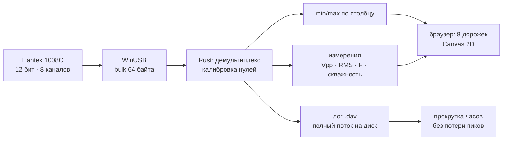
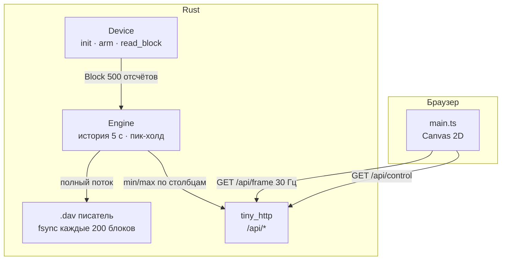

# Осциллограф Хелтег да Винчи

Замена вендорскому ПО для восьмиканального USB-осциллографа **Hantek 1008C**
(USB `0783:5725`). Сырые 12-битные отсчёты, настоящие вольты, непрерывный лог и
интерфейс, который не прячет пики за «квадратиками».


## Зачем ещё один осциллограф

Штатная программа рисует один отсчёт на пиксель: фронт превращается в ступеньку,
а глитч между пикселями исчезает совсем. Здесь на каждый столбец считается
**настоящий минимум и максимум**, поэтому пик видно всегда — включая одиночный
выброс на CH7, который на скриншоте торчит одной вертикальной чертой.



## Что уже работает

| Узел | Состояние | Проверено на |
|---|---|---|
| Протокол, команды, демультиплекс | готово | юнит-тесты + симулятор |
| Калибровка нулей по трём диапазонам | готово | юнит-тесты |
| Измерения (Vmin/Vmax/Vpp/RMS/частота/скважность) | готово | тест «меандр 1 кГц, 25 %» |
| Демон + HTTP API | готово | `--sim`, живой опрос |
| Интерфейс на 8 дорожек | готово | скриншот выше |
| Непрерывный лог `.dav` | готово | запись/чтение в симуляторе |
| WinUSB: устройство открывается, bulk-каналы найдены | готово | живой прибор |
| WinUSB: инициализация целиком | готово | живой прибор |
| WinUSB: чтение буфера отсчётов | готово | живой прибор: 500 отсчётов/блок, 17 блоков/с |
| Честная ось времени из развёртки | готово | 500 µs/div → окно 5 мс, 100 кОТС/с |
| Драйвер: привязка к WinUSB без Zadig | готово | `pnputil` + живой прибор |
| Установщик, ярлыки, удаление | готово | полный цикл на этой машине |
| Вендорский драйвер | отключён | опасен, см. ниже |

> **Важно.** Прямой доступ к драйверу Hantek (`DSO6CDE`) отключён по умолчанию:
> на этой машине он дважды привёл к синему экрану `0x3B`. Подробности и
> доказательства — в [docs/REVERSE-ENGINEERING.md](docs/REVERSE-ENGINEERING.md).

## Установка

Два файла, и больше ничего: ни Node, ни Python, ни отдельного менеджера
драйверов.

| Файл | Что это | Размер |
|---|---|---|
| `DaVinci-Setup.exe` | установщик: раскладывает программу, ставит драйвер, делает ярлыки | ~1,0 МБ |
| `DaVinci.exe` | программа одним файлом, интерфейс внутри — можно носить на флешке | ~0,8 МБ |

Оба файла лежат в [dist/](dist/) этого репозитория (их собирает
`tools/build-dist.ps1`) — скачивать и ставить можно без Rust и Node.

Установщик делает четыре шага и один раз спрашивает разрешение администратора:


Проверить, что всё на месте, можно одной командой:

```powershell
& "C:\Program Files\DaVinci\davinci.exe" doctor
```

Она показывает прибор, его службу, состояние WinUSB, порт, папку журналов и
размер встроенного интерфейса. Если прибор не на WinUSB — лечится так:

```powershell
& "C:\Program Files\DaVinci\davinci.exe" doctor --fix
```

Удаление — «Программы и компоненты» → «Осциллограф Хелтег да Винчи», или
`davinci uninstall`. Драйвер при удалении остаётся: он принадлежит системе, а не
программе (как снять — написано в [driver/README.md](driver/README.md)).

Подробности, включая что именно установщик делает с хранилищем сертификатов:
[docs/INSTALL.md](docs/INSTALL.md).

## Сборка из исходников

```powershell
# интерфейс (один раз; нужен Node)
cd ui; npm ci; npm run build; cd ..

# программа + установщик в dist\
pwsh tools\build-dist.ps1
```

Без установщика:

```powershell
.\dist\DaVinci.exe --sim          # интерфейс без прибора
.\dist\DaVinci.exe                # боевой режим, браузер откроется сам
```

Откат драйвера на вендорский: Диспетчер устройств → `HANTEK1008` → Обновить
драйвер → указать `C:\Program Files (x86)\Hantek\Scope1008\Driver\Windows10`.


## Что за железо

| Параметр | Значение | Комментарий |
|---|---|---|
| Каналов | 8 | плюс 8 цифровых выходов (не используем) |
| АЦП | 12 бит | 4096 кодов, шаг 0,01 В на диапазоне ±20 В |
| Поток | 2,4 млн отсчётов/с суммарно | делится на число включённых каналов |
| На канал при 8 включённых | 300 квыб/с | при одном канале — 2,4 Мвыб/с |
| Память | 4K отсчётов на канал | буферы по 2000 |
| Диапазоны | ±0,41 В · ±2,5 В · ±20 В | переключаются на канал |
| Вход | 1 МОм, DC | |

Отсюда честная оценка лога: 8 каналов × 300 квыб/с × 2 байта ≈ **4,8 МБ/с**,
то есть около 17 ГБ в час. Это спокойно пишется на SSD.

## Архитектура



* `crates/hantek1008` — протокол, WinUSB-транспорт, калибровка, симулятор.
* `crates/davinci` — демон, движок, лог, HTTP, CLI.
* `ui` — TypeScript + Vite + CSS, рендер на Canvas 2D.

## API

| Метод | Что делает |
|---|---|
| `GET /api/info` | состояние связи, частота, блоки/с, лог |
| `GET /api/channels` | по каналу: min, max, Vpp, RMS, частота, скважность, пик-холд |
| `GET /api/frame?width=&span=` | бинарный кадр: на столбец min и max в мВ |
| `GET /api/control?cmd=run\|stop\|reset` | управление захватом |
| `GET /api/control?cmd=channels&list=1,2` | включённые каналы |
| `GET /api/control?cmd=range&ch=3&r=3` | диапазон канала |
| `GET /api/control?cmd=log_start\|log_stop` | непрерывный лог |

## План

- [x] Протокол, демультиплекс, калибровка, измерения
- [x] Демон, HTTP, интерфейс, лог
- [x] Привязка к WinUSB без Zadig — установщик ставит драйвер сам
- [x] Установщик, ярлыки, удаление через «Программы и компоненты»
- [x] Чтение буфера отсчётов на живом приборе
- [x] Ось времени из развёртки: один блок = один экран
- [ ] Прокрутка по сохранённому логу в интерфейсе
- [ ] Режимы Trigger/Scan/Roll из libsigrok
- [ ] Экспорт в CSV/Parquet

## Лицензия

MIT. Протокол восстановлен независимо; в основе понимания лежат открытые работы
[mfg92/hantek1008py](https://github.com/mfg92/hantek1008py) и
[sigrok](https://sigrok.org/wiki/Hantek_1008C).

