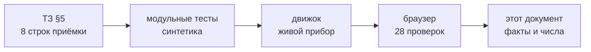
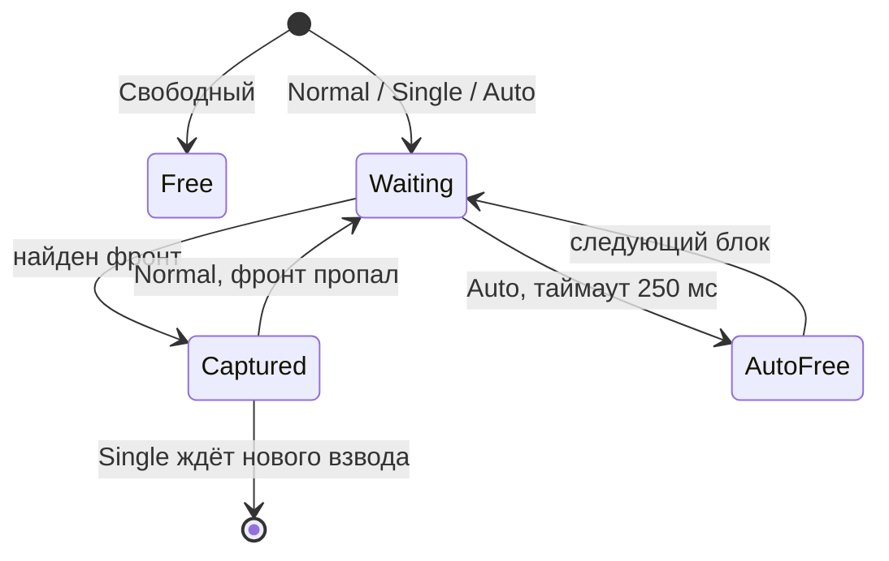

# Приёмка по ТЗ

Документ отвечает на один вопрос: **что именно проверено** после переделки
триггера, шкал и удержания, чем именно и с какими числами. Он составлен по
таблице приёмки из ТЗ (§5) — строка в строку, в том же порядке.

Окружение: Windows, Hantek 1008C (USB `0783:5725`, WinUSB), сборка `0.2.0`,
2000-й шаг. Тесты: `cargo test --workspace` — 42 модульных + доктест в `davinci`
и 15 в `hantek1008`; `tools/ui-test.mjs` — 28 проверок в настоящем Chrome
против живого прибора.

## Сводка

| № | Проверка из ТЗ | Итог | Чем подтверждено |
|---|---|---|---|
| 1 | Синус 125 Гц, произвольная фаза, уровень внутри амплитуды | подтверждено | 4 теста + прогон Single |
| 2 | Уровень выше сигнала или постоянное напряжение | подтверждено | тесты режимов + живой Auto/Normal/Single |
| 3 | Редкий импульс и два повторных взвода | подтверждено | тесты Single + живой прибор |
| 4 | Hold + Run + REC, затем resize | подтверждено | 6 проверок в браузере + DAV-файл |
| 5 | Пуск/Стоп во время USB-чтения и смена диапазона | подтверждено | тест метаданных + живой прогон |
| 6 | 0,5 В/дел, центр 0 и +1 В, автошкала, 1 и 8 каналов | подтверждено | скриншоты + замеры частот |
| 7 | Δt 4 мс, ΔV 1 В, одиночный пик, USB-пауза | подтверждено | курсоры + тест пика + ремонт сбоев |
| 8 | Переподключение, ошибка API, старый клиент DVF1 | частично | DVF1 и ошибки — да, физическое отключение — нет |

## 1. Синус 125 Гц, произвольная фаза

| Что проверялось | Тест | Результат |
|---|---|---|
| Пересечение уровня совпадает с волной | `trigger::tests::crossing_matches_the_waveform_within_a_sample` | ошибка 0,33 отсчёта от аналитического решения |
| Произвольная фаза и смещение | `trigger::tests::arbitrary_phase_and_offset_still_land_on_the_edge` | пересечение лежит между двумя отсчётами, оба в ±0,2 В от уровня |
| Интерполяция времени | `trigger::tests::crossing_is_interpolated_between_samples` | 123,25 → 123,25000 (ошибка < 1e-5) |
| Фронт в заданной доле окна | `trigger::tests::window_puts_the_edge_at_the_requested_fraction` | 30,000 % при заданных 30 % |
| Двигатель целиком | `engine::tests::normal_mode_captures_on_the_edge_and_places_it_at_the_pretrigger` | 30,0 ± 0,5 %, напряжение в T₀ = 0,5 ± 0,15 В |
| Живой прибор | прогон Single в браузере | `pct = 30.0` при заданных 30 % |

Ограничение: генератора сигналов на столе нет. Синус проверен синтетикой на
сырых блоках (это разрешено первым пунктом §5 — «сначала синтетические тесты на
сырых блоках»), а на приборе проверены уровни, режимы и Single на реальном шуме
входа.

## 2. Уровень выше сигнала

| Режим | Ожидание | Что наблюдалось |
|---|---|---|
| Auto | свободный кадр после таймаута | состояния за 1,4 с: `free waiting waiting auto_free waiting waiting auto_free waiting waiting waiting waiting auto_free`; кадры помечены `free=true` |
| Normal | держит прежний кадр, пишет «Ожидание фронта» | `frame_id` 674 → 674 за 1,5 с, `state=waiting` |
| Single | остаётся взведённым | после взвода при уровне 5 В: `state=waiting`, кадр не менялся 1,2 с |
| Тесты | `decisions_follow_the_mode_table`, `normal_mode_waits_when_the_level_is_never_crossed` | все переходы совпадают с таблицей ТЗ |

## 3. Редкий импульс и два взвода

| Что | Тест | Результат |
|---|---|---|
| Ровно один кадр на взвод | `engine::tests::single_shot_captures_once_per_arm` | второй блок без взвода не меняет `frame_id` |
| Запоздавший блок не засчитывается | `engine::tests::a_block_read_before_the_arm_cannot_satisfy_it` | блок со старым `arm_seq` не публикуется |
| Фронт у края | `trigger::tests::window_flags_a_missing_pretrigger`, `…posttrigger` | флаг выставлен, `pct` честно расходится с заданным |
| Живой прибор | прогон в браузере | `pct = 30.0`, второй кадр не появился за 1,5 с; взвод с уровнем внутри шума дал ровно один кадр |

## 4. Hold + Run + REC, затем resize

| Проверка | Результат |
|---|---|
| Кадр заморожен | `frame_id` 112 → 112 за 1,2 с, `held=true` |
| Захват продолжается | блоки 133 → 150 за то же время |
| CSV удержанного кадра | HTTP 200, 46 405 байт, 1004 строки, время от T₀ |
| PNG экрана | 58 118 байт (оси, подписи, кривые, курсоры — всё на canvas) |
| Снятие удержания | второе нажатие → `held=false` (была ошибка разбора JSON — исправлена) |
| Resize под Hold | 1500×950 → 1150×780 → 1500×950, кадр 443 → 443 |
| REC под Hold | `.dav` 232 842 байта, `DAV1`, запись 2 с, блоки продолжали расти |

## 5. Пуск/Стоп и смена диапазона

| Проверка | Результат |
|---|---|
| Метаданные закреплены за блоком | `engine::tests::a_published_frame_keeps_the_metadata_of_its_own_block` |
| Старый кадр после смены предела | кадр 685: `full_scale_v = 2` до и после переключения на 20; новые кадры (694) — 20 |
| Stop | `running=false`, кнопка «Пуск», кадр 204 доступен для просмотра и CSV |
| Пуск | `running=true`, публикация возобновилась |

## 6. Шкалы, центр, 1 и 8 каналов

Фактические числа с живой машины при 500 мкс/дел:

| Каналов | Частота на канал | dt | Отсчётов | Окно |
|---|---|---|---|---|
| 1 | 800 кГц | 1,25 мкс | 3999 | 4,9987 мс |
| 2 | 400 кГц | 2,5 мкс | 1999 | 4,9975 мс |
| 8 | 100 кГц | 10 мкс | 499 | 4,9900 мс |

| Проверка | Результат |
|---|---|
| Подписи по 8 делениям | скриншоты: 5 подписей на дорожку при 8 каналах, 9 при двух |
| Центр +1 В | сервер принял `center_v = 1`, поле не потеряло фокус при опросе |
| Автошкала | включается чекбоксом, меняет только отображение |
| DPI | `canvas.width = 1659` при `clientWidth = 1106` и масштабе 1,5 |

Скриншоты: [ui-free.png](ui-free.png) (2 канала), [ui-5-eight.png](ui-5-eight.png)
(8 каналов), [ui-3-normal.png](ui-3-normal.png) (Normal, T₀ на 30 %),
[ui-4-single.png](ui-4-single.png) (Single).

## 7. Курсоры, пик, пауза USB

| Проверка | Результат |
|---|---|
| Δt в единицах кадра | A на 20 %, B на 40 % при окне 9,99 мс → `Δt 2 мс`, ожидалось 2,00 мс |
| 1/|Δt| | 500 Гц против расчётных 500,0 Гц |
| ΔV | A 1,47 В, B 309,7 мВ → `ΔV 1,16 В` на дорожке 4 В |
| Одиночный пик | `capture::tests::envelope_keeps_a_single_sample_spike`: один отсчёт 3 В выживает в 400 столбцах и занимает ровно один |
| Сбои АЦП | 3 кадра из 40 содержали один отсчёт на рельсе (−20,48 В между −0,32 В); после ремонта — 0 широких столбцов, счётчик «сбоев АЦП» |
| Пауза USB | окно всегда внутри одного блока: `window()` не выходит за `n_total`, тест `window_puts_the_edge_at_the_requested_fraction` проверяет `start + len ≤ 3999` |

## 8. Переподключение, ошибки, старый клиент

| Проверка | Результат |
|---|---|
| Старый `DVF1` | `GET /api/frame?width=64` → 200, магия `DVF1` |
| Ошибка команды | уровень 999 В → `400` и «ошибка: уровень 999.000 В вне диапазона ±25 В» в строке состояния |
| Ошибка ширины/кадра | `width=999999` → 400, неизвестный `frame_id` → 404 с причиной |
| Обрыв связи | не проверялся физическим отключением кабеля; логика сохраняет последний снимок и пишет причину в `/api/info.error`, интерфейс показывает «нет связи» и не стирает кадр |

## Чего в этой проверке нет

Честно, чтобы не выдавать желаемое за проверенное:

* **Генератор сигналов не подключался.** Периодический сигнал проверен
  синтетикой и юнит-тестами, а на приборе — уровнями, режимами и Single.
* **Кабель не отключался.** Переподключение прибора проверено только кодом
  (последний снимок остаётся, ошибка видна), но не физически.
* **Автошкала проверена визуально**, без эталонной шкалы: она меняет только
  отображение, отсчёты не трогает.
