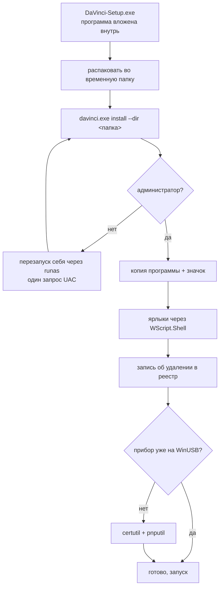

# Установка, драйвер и удаление

Документ отвечает на три вопроса: что кладёт на диск установщик, что он делает
с драйвером прибора, и как всё это откатить.

## Коротко

```powershell
# установить
.\dist\DaVinci-Setup.exe

# проверить
& "C:\Program Files\DaVinci\davinci.exe" doctor

# починить драйвер, если прибор не на WinUSB
& "C:\Program Files\DaVinci\davinci.exe" doctor --fix

# удалить
& "C:\Program Files\DaVinci\davinci.exe" uninstall
```

## Что появляется на машине

| Путь | Что это | Удаляется вместе с программой |
|---|---|---|
| `C:\Program Files\DaVinci\davinci.exe` | программа, интерфейс внутри | да |
| `C:\Program Files\DaVinci\davinci.ico` | значок для ярлыков | да |
| `%ProgramData%\...\Start Menu\Programs\Осциллограф да Винчи.lnk` | ярлык в «Пуске» | да |
| `%USERPROFILE%\Desktop\Осциллограф да Винчи.lnk` | ярлык на рабочем столе | да |
| `HKLM\...\Uninstall\DaVinciHantek1008` | запись в «Программах и компонентах» | да |
| `%LOCALAPPDATA%\DaVinci\` | калибровка, журналы, номер порта | только с `--purge` |
| Драйвер WinUSB для `0783:5725` | привязка прибора | нет, остаётся системе |

Программа ничего не пишет рядом с собой: `Program Files` доступна только на
чтение, поэтому всё изменяемое живёт в `%LOCALAPPDATA%\DaVinci`.

## Как устроен установщик



Логика установки существует ровно в одном месте — в `davinci install`. Мастер
`DaVinci-Setup.exe` только распаковывает программу и вызывает её. Второй
экземпляр этой логики в установщике неизбежно разошёлся бы с первым, причём
молча.

## Драйвер: зачем он вообще нужен

Прибор приходит с драйвером Hantek `DSO6CDE` (2017 год, WDM). Прямой доступ к
нему на этой машине дважды приводил к синему экрану `0x3B` — подробности в
[REVERSE-ENGINEERING.md](REVERSE-ENGINEERING.md). Поэтому программа работает
через универсальный **WinUSB**: в ядре нет ни строчки вендорского кода, и худший
исход ошибки — упавший процесс, а не машина.

Привязка делается тремя командами, которые установщик выполняет сам:

| Шаг | Команда | Зачем |
|---|---|---|
| 1 | `certutil -addstore -f Root davinci-libwdi.cer` | корневой сертификат, которым подписан каталог пакета |
| 2 | `certutil -addstore -f TrustedPublisher davinci-libwdi.cer` | разрешение на установку пакета от этого издателя |
| 3 | `pnputil /add-driver ydj-2088.inf` | пакет в хранилище: `Include=winusb.inf`, `Needs=WINUSB.NT` |
| 4 | `UpdateDriverForPlugAndPlayDevices(…, INSTALLFLAG_FORCE)` | привязка пакета к прибору **в обход ранжирования** |
| 5 | `pnputil /scan-devices` | попросить PnP перечитать устройство |

### Почему шаг 4 нельзя заменить на `pnputil … /install`

Проверено на живом приборе, а не выведено из документации. Когда к одному
Hardware ID подходят два пакета, Windows выбирает по ранжированию, а у него в
числе прочих признаков — `DriverVer`:

| Пакет | `DriverVer` | Кто выбирает |
|---|---|---|
| вендорский `oem105.inf` (Hantek) | 09/11/2017 | **Windows, по умолчанию** |
| `ydj-2088.inf` (WinUSB) | 06/02/2012 | только принудительно |

`pnputil /add-driver … /install` один раз уже переключил прибор обратно на
`DSO6CDE` прямо во время установки — устройство перечислилось заново, и
ранжирование выбрало вендорский пакет. Поэтому привязка делается через
`newdev!UpdateDriverForPlugAndPlayDevices` с флагом `INSTALLFLAG_FORCE` — это та
же операция, что делает Zadig кнопкой `Replace Driver`.

Тот же урок объясняет, почему `davinci doctor` считает готовностью пару
«служба = `WinUSB` **и** интерфейс найден»: сразу после смены драйвера в системе
остаётся устаревшая запись интерфейса, и одной её недостаточно.

### Про сертификат — честно

Каталог `.cat` подписан самодельным сертификатом `CN=USB\VID_0783&PID_5725
(libwdi autogenerated)`, потому что Microsoft не подписывает драйверы для
устройств, которых нет в её списке. Такой сертификат обязан лежать в хранилище
**доверенных корневых** — иначе Windows откажется ставить пакет («третья сторона
без цифровой подписи», проверено).

Что это значит на практике:

* сертификат выпущен только для этой привязки, срок действия — до 2029 года;
* он уже был установлен на этой машине программой Zadig, когда драйвер менялся
  вручную; установщик просто делает то же самое без участия человека;
* удалить его можно в любой момент: `certutil -delstore Root "USB\VID_0783&PID_5725 (libwdi autogenerated)"`
  и то же для `TrustedPublisher`;
* происхождение файлов пакета описано в [driver/README.md](../driver/README.md).

Если такая политика неприемлема, есть альтернатива без установки драйвера:
поставить Zadig и нажать в нём `Replace Driver` вручную — результат тот же.

## Диагностика

`davinci doctor` проверяет всю цепочку и называет виновника:

| Строка отчёта | Что означает |
|---|---|
| `прибор` | найден ли узел `USB\VID_0783&PID_5725` и какая служба им владеет |
| `winusb` | отдаёт ли устройство интерфейс WinUSB (это и есть готовность) |
| `связь` | открывается ли прибор и проходит ли инициализацию |
| `порт` | свободен ли порт интерфейса (занят = программа уже запущена) |
| `состояние` | можно ли писать в папку калибровки и журналов |

Коды возврата: `0` — всё в порядке, `1` — есть проблемы, `2` — неизвестная
команда или отказ от опасного действия.

## Удаление

```powershell
& "C:\Program Files\DaVinci\davinci.exe" uninstall          # программа
& "C:\Program Files\DaVinci\davinci.exe" uninstall --purge  # ещё и журналы/калибровка
```

Удаление отказывается работать, если запущено не из папки установки: иначе копия,
запущенная прямо из `target\release`, снесла бы сборочное дерево. Проверка — имя
папки `DaVinci` либо запись в реестре с этим путём.

Драйвер остаётся. Снять его совсем:

```powershell
pnputil /delete-driver oem184.inf /uninstall /force
certutil -delstore Root "USB\VID_0783&PID_5725 (libwdi autogenerated)"
```

