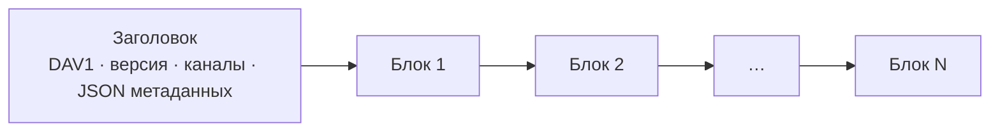

# Формат лога `.dav`

Один файл — одна сессия записи. Полный поток без потерь, плюс заголовок с
калибровкой, чтобы старые записи читались теми же вольтами, что и в момент
записи.

## Раскладка

| Поле | Размер | Что внутри |
|---|---|---|
| magic | 4 | `DAV1` |
| версия | 2 | сейчас `1` |
| каналов | 2 | `8` |
| флаги | 4 | зарезервировано |
| длина JSON | 4 | байты |
| JSON | переменно | частоты, диапазоны, нули, id времени/деления |

Каждый блок:

| Поле | Размер | Что внутри |
|---|---|---|
| длина | 4 | размер остатка блока |
| seq | 8 | номер блока |
| t_ns | 8 | монотонное время чтения |
| n | 2 | отсчётов на канал |
| маска | 1 | какие каналы писались |
| данные | n × 2 × каналов | i16, по каналам подряд |

## Почему так

- **i16, а не float** — код АЦП занимает 12 бит, двух байт хватает с запасом,
  а объём вдвое меньше.
- **Ноль и диапазон в заголовке** — лог остаётся читаемым, даже если калибровку
  потом перемеряют.
- **fsync каждые 200 блоков** — при 8 каналах это примерно раз в 0,7 с: диск не
  молотит впустую, но потерять при сбросе питания можно не больше секунды.
- **Без сжатия в v1** — 12-битные шумные отсчёты жмутся плохо; сжатие появится,
  когда будет измерен реальный выигрыш на записях по 10+ минут.

## Что дальше

- [ ] Индекс по времени для мгновенного перехода к метке
- [ ] Пирамида min/max внутри файла — прокрутка часов без чтения всего потока
- [ ] Чтение `.dav` в интерфейсе (сейчас пишется, но не открывается)
- [ ] Экспорт в CSV и Parquet
