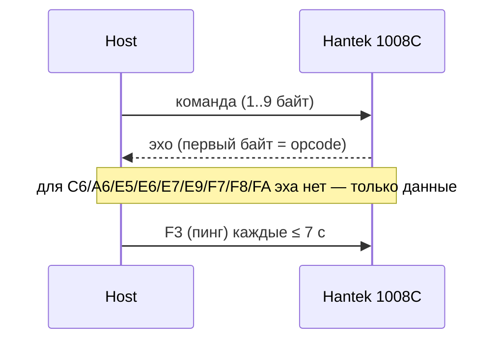
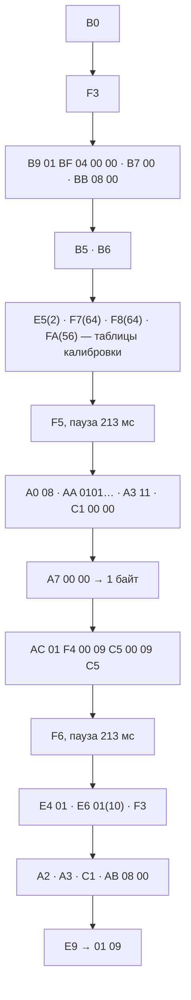
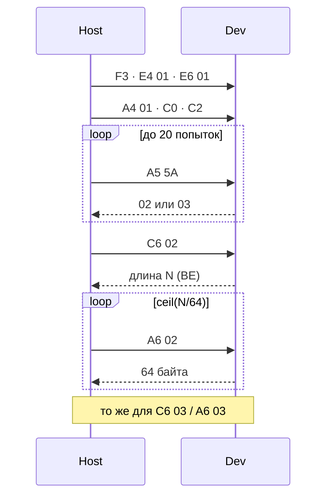
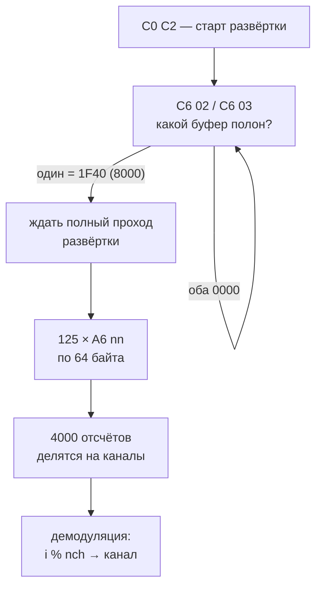

# Протокол Hantek 1008C

Команды и последовательности восстановлены независимо и сверены с открытыми
работами. Всё общение — короткие кадры до 64 байт в каждую сторону.

## Правила обмена



Если не отправлять команды дольше ~7 секунд, устройство «отключается» логически
и требуется переинициализация. Поэтому пинг входит в каждый цикл захвата.

## Команды

| Opcode | Назначение | Параметр | Ответ |
|---|---|---|---|
| `0xB0` | рукопожатие | — | эхо |
| `0xF3` | пинг / keepalive | — | эхо |
| `0xA0` | число включённых каналов | 1..8 | эхо |
| `0xAA` | маска каналов | 8 байт 0/1 | эхо |
| `0xA2` | диапазон на канал | 8 байт (1..3) | эхо, пауза 213 мс |
| `0xA3` | время/деление | id 0..25 | эхо |
| `0xAB` | уровень триггера | 2 байта BE | эхо |
| `0xC1` | источник и фронт | канал, 0/1 | эхо |
| `0xA4` | режим | `01` — burst | эхо |
| `0xC0`, `0xC2` | старт выборки | — | эхо |
| `0xA5 0x5A` | данные готовы? | — | `2` или `3` |
| `0xC6` | длина буфера | `02`/`03` | 2 байта BE |
| `0xA6` | чтение буфера | `02`/`03` | 64 байта |
| `0xAC` | регистры частоты | 8 байт | эхо |

## Инициализация



## Цикл захвата

Один блок — это два буфера по 2000 16-битных слов, то есть 4000 слов на все
включённые каналы. При восьми каналах это 500 отсчётов на канал.



## Из отсчётов в вольты

Слова идут вперемешку по включённым каналам: отсчёт `i` принадлежит каналу
`enabled[i % n]`. Дальше простая арифметика:

```
вольт = (код − ноль_канала) × 0,01 × vscale
vscale: 1.0 → ±20 В · 0.125 → ±2,5 В · 0.02 → ±0,41 В
```

Ноль измеряется отдельно для каждого канала и диапазона: он уплывает при
прогреве (до десятков мВ на диапазоне ±20 В), и без компенсации прибор врёт.

## Что осталось за кадром

- Режимы Scan и Roll (`0xC7`/`0xC8`) — в планах, нужны для длинных развёрток.
- Генератор цифровых выходов (`0xB7`/`0xB8`/`0xB9`/`0xBF`) — не используем.
- Точная зависимость частоты от времени/деления зависит от числа каналов;
  поэтому частота в программе измеряется, а не берётся из таблицы.

## Особенности нашей ревизии

Обмен снят командами `davinci dump` на живом приборе (YDJ-2088, WinUSB).
Ответы заметно отличаются от эталонной реализации — поэтому в коде проверка эха
заменена на «отправить и вычитать всё, что пришло».

| Команда | Ответ нашей прошивки | Что ждёт эталон |
|---|---|---|
| `B0`, `F3`, `B9`, `B7`, `BB` | эхо, 1 байт | эхо |
| `B5`, `B6` | ничего | эхо |
| `E5` | 66 байт (`04 04 04 …`) | 2 байта `D6 06` |
| `F7`, `F8` | ничего | 64 байта таблицы |
| `FA` | 120 байт | 56 байт |
| `F5` | ничего | эхо |
| `A7` | эхо без байта статуса | эхо + `00` |
| `A0`, `AA`, `A3`, `C1`, `AC` | 0–1 байт, нестабильно | эхо |
| `C6 02` после старта | `00 00` (длина 0) | длина буфера |

## Что оказалось на самом деле

Инициализация проходила целиком с самого начала. Ломались две вещи, обе — на
стороне хоста.



### Буфер не «второй», а «тот, где данные»

Код всегда читал буфер `02`, а потом `03`. На этом приборе заполняется **тот
или другой**, в зависимости от того, куда повернулась прошивка: `C6 02` отдаёт
`00 00`, `C6 03` — `1F 40`. Отсюда и `implausible buffer length 0`.

Правильно: спросить оба и читать все непустые.

### Длина появляется раньше данных

`C6` сообщает, **сколько придёт**, а не сколько уже пришло. Если начать читать
сразу, первый же пакет попадает в момент, когда прошивка пишет в буфер, и
отсчёты под указателем записи читаются как `0` — это нижняя шина АЦП, то есть
на экране нарисованный выброс на весь диапазон.

Замер на живой выборке (30 блоков × 8 каналов, ожидание в мс):

| Ожидание после `C6` | Глючных каналов |
|---|---|
| 0 мс | 5 из 1200 |
| 9 мс (один проход + 4 мс) | 0 из 1200 |
| 20 мс | 0 из 1200 |

Подтверждено на 400 блоках: 0 из 3200. Все глюки стояли на одной и той же
позиции 51 — то есть это был указатель записи, а не помеха в сигнале.

### Сколько данных за проход

Буфер фиксирован **по байтам**: 8000 байт = 4000 отсчётов на весь экран,
поровну между включёнными каналами.

| Каналов | Отсчётов на канал |
|---|---|
| 1 | 4000 |
| 2 | 2000 |
| 4 | 1000 |
| 8 | 500 |

Поэтому частота дискретизации не измеряется по USB, а выводится из развёртки:

```
частота = (4000 / каналов) / (10 × нс_на_деление / 1e9)
```

При 500 µs/div и восьми каналах это ровно 100 000 Гц. Пропускная способность
USB (~20 блоков/с) — это частота обновления экрана, а не частота отсчётов;
раньше её путали, и все измерения частоты уезжали вместе с нагрузкой на шину.

## Ограничение

Модель «один экран = 10 делений развёртки» верна на рабочих развёртках. На
самых быстрых (единицы нс/деление) implied-частота выходит за физический
предел АЦП, и время по оси перестаёт быть честным. Для измерений на таких
развёртках нужен реальный предел прибора из документации.


