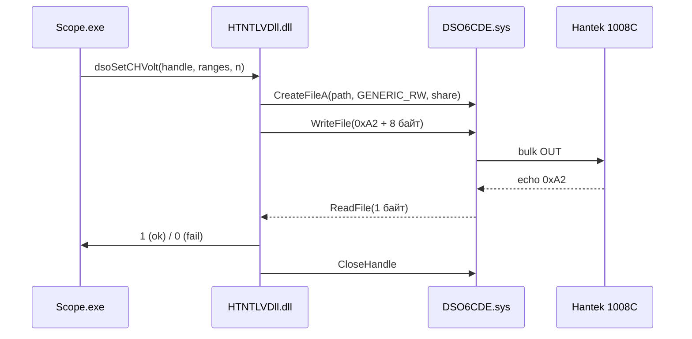
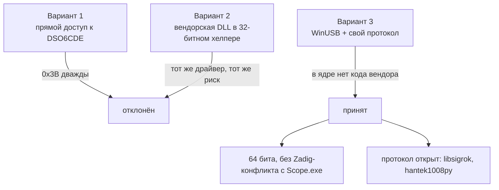

# Как устроен вендорский драйвер и почему мы от него ушли

Этот документ фиксирует разбор `HTNTLVDll.dll` и причину, по которой проект
работает через WinUSB, а не через драйвер Hantek. Здесь же — доказательства
двух синих экранов, чтобы никто не повторил этот путь случайно.

## Что выяснилось про DLL

`HTNTLVDll.dll` (62 экспорта, x86, 2018 год) — не библиотека логики, а тонкий
passthrough. Каждая функция делает одно и то же:

Разбор `dsoSearch` (VA `0x10005B70`) дал путь к устройству: DLL перечисляет
интерфейсы по GUID `{4B6C73B2-015B-4855-8BB1-A7A6C03AFA87}` и фильтрует строки
по `#vid_0783&pid_5725#`. Дальше — `CreateFileA` с `FILE_FLAG_OVERLAPPED` и
`WriteFile`/`ReadFile` с таймаутом 1 с. Никаких `DeviceIoControl`, никаких
IOCTL-кодов.

| Находка | Значение | Откуда |
|---|---|---|
| GUID интерфейса | `{4B6C73B2-015B-4855-8BB1-A7A6C03AFA87}` | `read_bytes @ 0x100451E0` |
| Транспорт | `CreateFileA` + `WriteFile`/`ReadFile` | декомпиляция `FUN_100029B0`, `FUN_10002D80`, `FUN_10002A80` |
| Драйвер | `DSO6CDE.sys`, v3.4.7.0, 2017 год | PnP + `Win32_SystemDriver` |
| Протокол | тот же, что у открытых реверсов | совпал байт в байт |

## Почему это плохая идея

Соблазн был сильный: драйвер уже стоит, ставить ничего не надо. Но как только
наш процесс открыл устройство **вторым клиентом** (вендорская программа при
этом работала), драйвер начал отдавать `ERROR_GEN_FAILURE` на чтение, а затем
уронил ядро.

| Что | Значение |
|---|---|
| Код BugCheck | `0x3B` SYSTEM_SERVICE_EXCEPTION |
| Параметр 1 | `0xC0000046` |
| Параметры 2–4 | `0`, адрес trap frame, `0` |
| Когда | 15:12 и 15:17, сразу после запуска `davinci info` |
| Отчёты | `Kernel_3b_*.cab`, одинаковые параметры |
| Что было до этого | ни одного `0x3B`; 06.11 — `0x116` (видеодрайвер, не наше) |

Вывод: сочетание «вендорское ПО держит прибор + наш прямой доступ» драйвер не
переживает. Это баг драйвера, но спровоцировали его мы, на рабочей машине.

## Решение

Вендорский транспорт остался в коде как `--features vendor-driver` — для машин с
другим драйвером — но по умолчанию выключен и помечен предупреждением.

## Что это значит на практике

- Прибор привязывается к WinUSB один раз (Zadig), после чего вендорское ПО его
  не видит, пока драйвер не вернут.
- Откат — одна операция: Диспетчер устройств → `HANTEK1008` → Обновить драйвер →
  `Driver\Windows10` из папки вендорской программы.
- Ни один компонент нашего кода не выполняется в режиме ядра.
