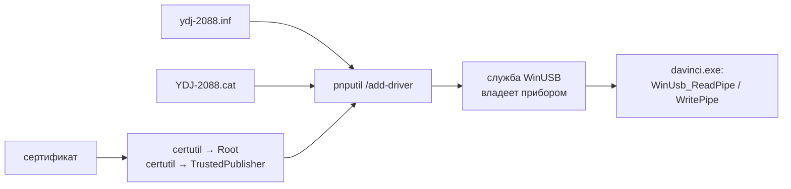

# Драйвер WinUSB для Hantek 1008C — что лежит в этой папке

Три файла, которые программа ставит сама, чтобы прибор перестал зависеть от
вендорского драйвера 2017 года (он же стал причиной двух синих экранов `0x3B`).

| Файл | Размер | Что это |
|---|---|---|
| `ydj-2088.inf` | 4704 Б | INF-пакет: `Class=USBDevice`, `Include=winusb.inf`, `Needs=WINUSB.NT`, одно устройство `USB\VID_0783&PID_5725` |
| `YDJ-2088.cat` | 4995 Б | каталог с хешами INF, подписанный сертификатом ниже |
| `libwdi-autogenerated.cer` | 1511 Б | открытая часть сертификата `CN=USB\VID_0783&PID_5725 (libwdi autogenerated)`, SHA-1 `E72DBB666400C2E28895CF6F0875CBFB46579949` |

## Откуда они взялись

Файлы извлечены из хранилища драйверов **этой же машины** после того, как
привязка к WinUSB была сделана вручную программой
[Zadig](https://zadig.akeo.ie/) (она собрана на библиотеке
[libwdi](https://github.com/pbatard/libwdi), автор Pete Batard, LGPL-3.0).

Windows импортировала пакет под именем `oem184.inf`, сохранив исходные имена
файлов в
`C:\Windows\System32\DriverStore\FileRepository\ydj-2088.inf_amd64_*`.
Оттуда они и скопированы — байт в байт, потому что каталог подписан именно этими
хешами и любое редактирование INF сделало бы подпись недействительной.

INF — шаблон libwdi (в нём так и написано: `Copyright (c) 2010-2023 Pete Batard`),
лицензия LGPL-3.0. Файл распространяется как есть, без изменений; полный текст
лицензии — <https://www.gnu.org/licenses/lgpl-3.0.txt>, исходники libwdi —
<https://github.com/pbatard/libwdi>.

## Что пакет делает с системой



* Устройство получает стандартный `winusb.sys` из состава Windows — ни одного
  стороннего `.sys` не устанавливается.
* В хранилище сертификатов добавляется самодельный корневой сертификат. Это
  требование политики подписи: без него Windows отказывается ставить пакет
  («The third-party INF does not contain digital signature information» —
  проверено на этой машине).
* Другие устройства пакет не затрагивает: в нём ровно один Hardware ID.

## Как снять

```powershell
pnputil /delete-driver oem184.inf /uninstall /force
certutil -delstore Root "USB\VID_0783&PID_5725 (libwdi autogenerated)"
certutil -delstore TrustedPublisher "USB\VID_0783&PID_5725 (libwdi autogenerated)"
```

После этого прибор вернётся к вендорскому драйверу (или останется без драйвера),
а `davinci doctor` снова скажет «нужен WinUSB».

## Как вернуть вендорский драйвер

Диспетчер устройств → `HANTEK1008` (или `YDJ-2088`) → Обновить драйвер → Найти
драйверы на этом компьютере → указать
`C:\Program Files (x86)\Hantek\Scope1008\Driver\Windows10`.

**Не запускайте нашу программу с вендорским драйвером**: сборка с функцией
`vendor-driver` существует только для исследования и на этой машине приводила к
`0x3B`.
